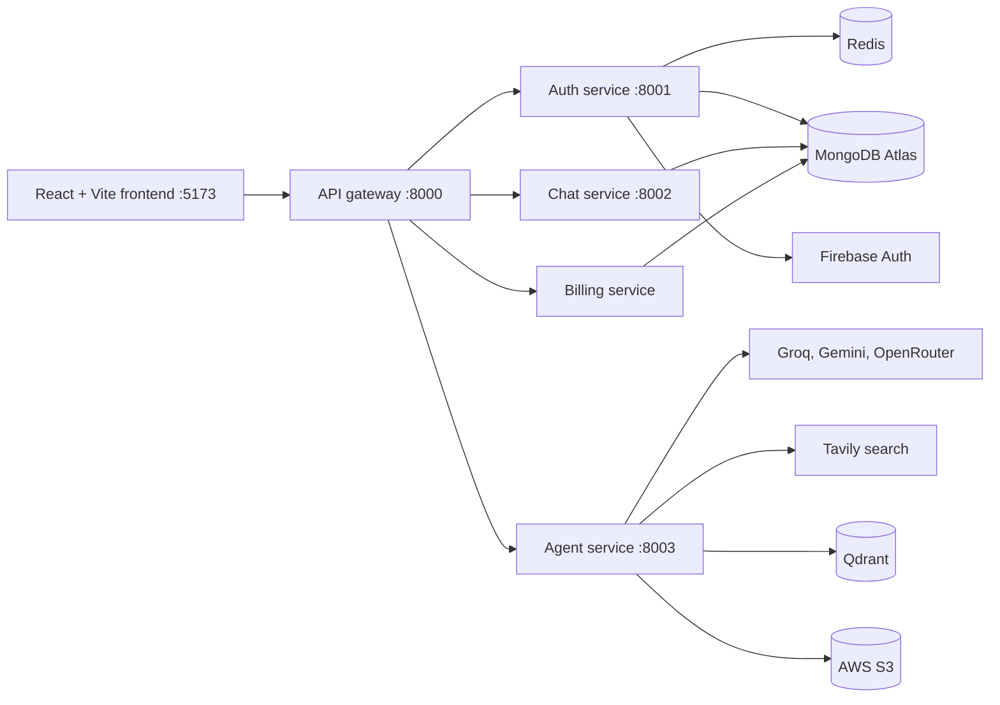

<div align="center">

# DARPAN

### Mirror of the Mind

A multi-agent AI workspace with a cinematic boot sequence, a 3D bot that reacts to your conversation in real time, and a microservice backend.


[Features](#features) · [Quick Start](#quick-start) · [Architecture](#architecture) · [The Bot](#the-bot) · [Troubleshooting](#troubleshooting) · [Roadmap](#roadmap)

<br />


</div>

<br />

## About

**Darpan** means *mirror*. The idea behind the project is an AI interface that reflects you back: a character that looks at you, listens while you type, thinks while it works, and smiles when it answers.

DARPAN is a full-stack AI chat platform. A React frontend with GSAP and Three.js talks to a set of Node.js microservices behind an API gateway. Requests are routed to specialised agents for chat, code, documents, presentations, vision and web search.

## Screenshots

| Boot sequence | Hero scene |
|:---:|:---:|
|  |  |

| Chat | Login |
|:---:|:---:|
|  |  |

## Features

### Experience

- **Cinematic boot sequence.** A HUD builds itself ring by ring, a counter runs to 100, boot logs type out, the word DARPAN decodes letter by letter, and the screen splits open like blast doors.
- **Fully synthesised sound design.** The hum, blips, letter ticks and door boom are generated at runtime with the Web Audio API, so no audio files are needed. An optional MP3 plays through a deep, robotic voice effect chain.
- **Click to initialize.** Browsers block audio until a user gesture, so the intro starts on a deliberate click. There is also an "enter without sound" option.
- **A 3D bot that reacts.** Its head and eyes follow your cursor, and its face changes with the state of the chat.
- **Real-time atmosphere.** Volumetric smoke shaders, tilted light beams, a glossy reflective floor, floating dust, bloom, vignette and film grain.
- **Accessible motion.** Animations are skipped when the system has `prefers-reduced-motion` enabled.

### Product

- **Multi-agent chat.** Auto, Chat, Coding, PDF, PPT, Vision and Search agents, selectable per message.
- **File input.** Attach PDFs and images for analysis.
- **Voice input.** Dictate with the Web Speech API.
- **Google sign-in.** Firebase authentication verified on the backend, with sessions backed by Redis.
- **Conversation history.** Titles, recents, collapsible sidebar and a mobile drawer.
- **Artifacts panel.** Generated outputs open beside the conversation.
- **Plans and billing.** A billing service and drawer for plan management.
- **Glass UI.** A translucent interface that lets the 3D scene show through.

## The Bot

The bot's expression is driven by a tiny shared store, so any part of the app can control it with one call.

```js
import { setBotMood } from './components/bot/botMood'

setBotMood('thinking')
```

| Mood | Trigger | Behaviour |
|---|---|---|
| `idle` | Nothing happening | Stern and neutral, head follows the cursor |
| `listening` | Typing or microphone active | Eyes widen, head tilts toward you |
| `thinking` | Message sent, waiting for the answer | Brows furrow, eyes narrow, gaze drifts away, a scanner ring spins |
| `speaking` | Answer received | Smiles, mouth moves, eyes soften, then returns to idle based on answer length |

While developing, the function is also exposed on `window`, so you can test moods from the browser console with `setBotMood('speaking')`.

### How it is built

- **Sculpted head.** A high-resolution sphere is deformed with gaussian displacement for the brow ridge, eye sockets, nose, cheekbones and chin.
- **Per-vertex materials.** A small `onBeforeCompile` patch gives the cowl a matte finish and the jaw a polished metal finish from a single mesh, with a smooth transition.
- **Procedural face.** Eyes, brows and a recessed mouth are animated from a shared pose table. The mouth is a ribbon bent every frame for smiles and speech.
- **Context-free state.** The mood lives in a module-level store that the render loop reads directly, which avoids bridging React context into the Three.js canvas.

## Tech Stack

| Layer | Technology |
|---|---|
| Frontend | React, Vite, Tailwind CSS, Redux Toolkit, Axios |
| Animation | GSAP, `@gsap/react` |
| 3D | Three.js, React Three Fiber, Drei, Postprocessing |
| Audio | Web Audio API, Web Speech API |
| Auth | Firebase Authentication |
| Backend | Node.js microservices behind an API gateway |
| Data | MongoDB Atlas, Redis, Qdrant (vector search) |
| AI | Groq, Google Gemini, OpenRouter, Tavily (web search) |
| Storage | AWS S3 |
| Tooling | Docker Compose, Nodemon |

## Architecture



### Services

| Service | Default port | Responsibility |
|---|---|---|
| Frontend | 5173 | UI, 3D scene, intro |
| Gateway | 8000 | Single entry point and CORS |
| Auth | 8001 | Google login, token verification, sessions |
| Chat | 8002 | Conversations and messages |
| Agent | 8003 | Agent routing, LLM calls, search, files |
| Billing | see its `.env` | Plans and payments |
| Redis | 6379 | Session and cache store |

## Quick Start

### Prerequisites

- Node.js 18 or newer
- Docker Desktop
- A MongoDB Atlas cluster with a database user and your IP allowed
- A Firebase project with Google sign-in enabled
- API keys for Groq, Google AI, OpenRouter and Tavily
- A Qdrant cluster and an AWS S3 bucket

### 1. Clone

```bash
git clone https://github.com/YOUR_USERNAME/darpan.git
cd darpan
```

### 2. Start Redis

```bash
cd backend
docker compose up -d
```

Check that it is running:

```bash
docker ps
```

### 3. Configure environment variables

Each service reads its own `.env` file. Create one inside every service folder under `backend/services/`.

<details>
<summary><b>Environment variable reference</b></summary>

<br />

| Variable | Used by | Description |
|---|---|---|
| `PORT` | All services | Port the service listens on |
| `MONGODB_URI` | Auth, Chat, Agent, Billing | MongoDB Atlas connection string |
| `REDIS_URL` | Auth, Agent | Redis URL, use `redis://127.0.0.1:6379` locally |
| `AUTH_SERVICE` | Agent | Base URL of the auth service |
| `CHAT_SERVICE` | Agent | Base URL of the chat service |
| `GROQ_API_KEY` | Agent | Groq API key |
| `GOOGLE_API_KEY` | Agent | Google AI (Gemini) API key |
| `OPENROUTER_API_KEY` | Agent | OpenRouter API key |
| `TAVILY_API_KEY` | Agent | Tavily web search key |
| `QDRANT_URL` | Agent | Qdrant cluster URL |
| `QDRANT_API_KEY` | Agent | Qdrant API key |
| `AWS_REGION` | Agent | S3 region |
| `AWS_ACCESS_KEY_ID` | Agent | AWS access key |
| `AWS_SECRET_KEY` | Agent | AWS secret key |
| `AWS_BUCKET_NAME` | Agent | S3 bucket name |

Example for the agent service:

```dotenv
PORT=8003
MONGODB_URI=your_mongodb_connection_string
REDIS_URL=redis://127.0.0.1:6379
AUTH_SERVICE=http://localhost:8001
CHAT_SERVICE=http://localhost:8002
GROQ_API_KEY=your_groq_key
GOOGLE_API_KEY=your_google_ai_key
OPENROUTER_API_KEY=your_openrouter_key
TAVILY_API_KEY=your_tavily_key
QDRANT_URL=your_qdrant_url
QDRANT_API_KEY=your_qdrant_key
AWS_REGION=ap-south-1
AWS_ACCESS_KEY_ID=your_aws_access_key
AWS_SECRET_KEY=your_aws_secret_key
AWS_BUCKET_NAME=your_bucket_name
```

</details>

The auth service also needs your Firebase **service account JSON** file. Download it from the Firebase console and keep it out of Git.

On the frontend, set your Firebase web config in `frontend/utils/firebase.js` and point `frontend/utils/axios.js` at the gateway, which is `http://localhost:8000` locally.

### 4. Run the backend services

Open one terminal per service and run the same commands in each.

```bash
cd backend/services/auth
npm install
npm run dev
```

Repeat for `gateway`, `chat`, `agent` and `billing`. The auth terminal should print:

```
auth started at 8001
redis connected
db connected
```

### 5. Run the frontend

```bash
cd frontend
npm install
npm run dev
```

Open **http://localhost:5173** and click **Initialize**.

The gateway allows requests from `http://localhost:5173` only. If Vite starts on another port, stop the old dev server so 5173 is free.

### Optional: voice greeting

Place an MP3 at `frontend/public/sounds/welcome-boss.mp3`. DARPAN plays it through a deep, robotic effect chain at the end of the boot sequence. Without the file, it falls back to the browser's own speech voice.

## Project Structure

```
darpan/
├── backend/
│   ├── docker-compose.yml
│   └── services/
│       ├── gateway/
│       ├── auth/
│       ├── chat/
│       ├── agent/
│       └── billing/
└── frontend/
    ├── public/
    │   └── sounds/
    ├── utils/
    │   ├── axios.js
    │   └── firebase.js
    └── src/
        ├── App.jsx
        ├── main.jsx
        ├── index.css
        ├── pages/
        │   └── Home.jsx
        ├── features/
        ├── redux/
        └── components/
            ├── JarvisIntro.jsx
            ├── JarvisIntro.css
            ├── jarvisAudio.js
            ├── SideBar.jsx
            ├── ChatArea.jsx
            ├── ChatInput.jsx
            ├── MessageList.jsx
            ├── Nav.jsx
            ├── Artifact.jsx
            ├── BillingDrawer.jsx
            └── bot/
                ├── BotScene.jsx
                ├── BotScene.css
                ├── ProceduralBot.jsx
                ├── Atmosphere.jsx
                ├── botPose.js
                └── botMood.js
```

## Scripts

| Command | Where | What it does |
|---|---|---|
| `npm run dev` | Frontend | Start Vite with hot reload |
| `npm run build` | Frontend | Production build into `dist/` |
| `npm run preview` | Frontend | Preview the production build |
| `npm run dev` | Each service | Start with Nodemon |
| `docker compose up -d` | `backend/` | Start Redis in the background |

## Performance Tuning

The scene is GPU heavy by design. On integrated graphics, use these levers.

| Goal | Change |
|---|---|
| Biggest saving | In `Atmosphere.jsx`, lower the `Floor` `resolution` to `256`, or swap it for a plain `meshStandardMaterial` |
| Fewer shader passes | Remove the third `<Smoke>` element |
| Lower pixel load | In `BotScene.jsx`, change `dpr={[1, 1.5]}` to `dpr={1}` |
| Skip post effects | Remove `Bloom` or `Noise` from `EffectComposer` |
| Brighter bot | Raise the `spotLight` intensity in `BotScene.jsx` |

## Browser Support

| Feature | Chrome / Edge / Brave | Firefox | Safari |
|---|---|---|---|
| 3D scene and animation | Yes | Yes | Yes |
| Boot sound | Yes | Yes | Yes |
| Voice input (Web Speech) | Yes | Limited | Limited |

WebGL 2 is required. In Brave, turn Shields off for `localhost` if the Google sign-in popup is blocked.

## Troubleshooting

| Problem | Cause | Fix |
|---|---|---|
| Google sign-in does nothing | Redis is not running | Run `docker compose up -d` in `backend/`, then restart the auth service |
| `ioredis ECONNREFUSED` in the auth terminal | Redis is down or `localhost` resolves oddly | Start Redis and set `REDIS_URL=redis://127.0.0.1:6379` |
| CORS error mentioning port `5174` | An old Vite server holds port 5173 | Stop it, restart the frontend, and confirm the terminal says `localhost:5173` |
| `Failed to resolve import "postprocessing"` | Missing peer dependency | Run `npm i postprocessing` and restart with `npm run dev -- --force` |
| `npm i` fails with `ERESOLVE` | React 18 with newest Three.js libraries | Install `@react-three/fiber@8 @react-three/drei@9 @react-three/postprocessing@2` |
| No sound in the intro | Browsers block audio before a click | Click **Initialize**, and check the tab is not muted |
| Popup blocked or closes instantly | Browser shields or popup blocker | Allow popups and disable Shields for `localhost` |
| Bot not visible | Solid backgrounds above the canvas, or compact mode | Keep the layout backgrounds transparent, and test on an empty New Chat |
| Mongo connection times out | IP not allowed in Atlas | Add your IP under Network Access |

## Roadmap

- [x] Cinematic boot sequence with synthesised audio
- [x] Reactive 3D bot with four moods
- [x] Smoke, volumetric light and reflective floor
- [x] Glass sidebar and chat input
- [ ] Restyle message list, bubbles and navigation
- [ ] Hero layout beside the bot
- [ ] Load realistic `.glb` avatars with ARKit blendshapes
- [ ] Lip-sync driven by audio
- [ ] Streaming responses
- [ ] Production deployment guide

## Contributing

Contributions are welcome.

1. Fork the repository
2. Create a branch: `git checkout -b feature/your-feature`
3. Commit your changes: `git commit -m "Add your feature"`
4. Push the branch: `git push origin feature/your-feature`
5. Open a pull request

## Security

Never commit `.env` files, API keys or the Firebase service account JSON. Rotate any key that has ever been shared publicly.

## License

Distributed under the MIT License. See `LICENSE` for details.

## Acknowledgements

[GSAP](https://gsap.com) · [Three.js](https://threejs.org) · [React Three Fiber](https://docs.pmnd.rs/react-three-fiber) · [Drei](https://github.com/pmndrs/drei) · [Postprocessing](https://github.com/pmndrs/postprocessing) · [Lucide](https://lucide.dev) · [Firebase](https://firebase.google.com) · [Groq](https://groq.com) · [Tavily](https://tavily.com) · [Qdrant](https://qdrant.tech)

The bot design is an original, Batman-inspired concept. This project is not affiliated with or endorsed by DC or Warner Bros.

<div align="center">

<br />

Built by **YOUR_NAME**

[GitHub](https://github.com/YOUR_USERNAME) · [LinkedIn](https://linkedin.com/in/YOUR_USERNAME)

If DARPAN impressed you, a star on the repo goes a long way.

</div>